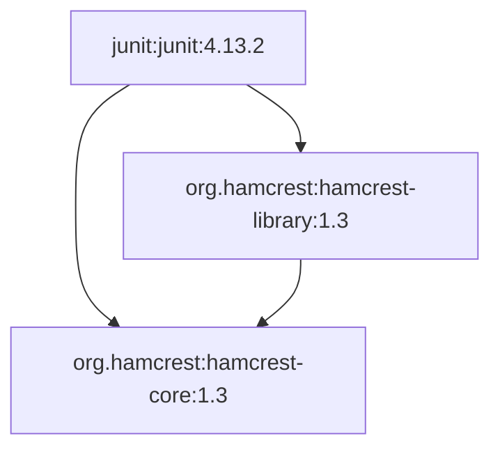

# Инструмент визуализации графа зависимостей (Вариант №19)

Проект разработан в рамках дисциплины «Конфигурационное управление».
Выполнил: Сопталев Никита Дмитриевич, ИКБО-32-25.

Вариант №19: инструмент визуализации графа зависимостей
для менеджера пакетов.
Текущее состояние: **Этап 5 (визуализация графа)**.

---

## 1. Общее описание

CLI-приложение на Python, которое читает параметры из YAML-файла,
проверяет их и строит граф зависимостей указанного Maven-пакета.

К пятому этапу приложение:

- принимает координаты пакета в формате `group:artifact:version`;
- получает прямые зависимости пакета из Maven-репозитория;
- проходит граф зависимостей в глубину без рекурсии;
- учитывает максимальную глубину анализа;
- находит циклы и не зацикливается на них;
- поддерживает тестовый режим с локальным файлом графа;
- печатает ребра графа в виде `пакет -> зависимость`;
- сохраняет режим вывода только прямых зависимостей по флагу
  `--direct` для демонстрации этапа 2;
- строит текстовое описание графа на языке Mermaid;
- при `ascii_tree: true` печатает зависимости в виде ASCII-дерева.

На четвертом этапе добавлен режим `--order`, который печатает
порядок загрузки пакета и его зависимостей. Порядок строится тем же
обходом в глубину, что и граф, но без повторного вывода узлов.
Результат сравнивается с настоящим Maven в разделе 7.

На пятом этапе добавлен режим `--mermaid`. Он печатает описание
графа на языке диаграмм Mermaid, а при включенном параметре
`ascii_tree` дополняет его ASCII-деревом. Результат сравнивается
со штатным выводом Maven `dependency:tree`.

Менеджеры пакетов (Maven, Gradle) и сторонние библиотеки для
получения зависимостей не используются. POM скачивается через
`urllib.request`, а разбирается через `xml.etree.ElementTree`.
Единственная внешняя зависимость проекта - PyYAML для чтения
конфигурации.

### История этапов

- Этап 1: CLI-прототип, проверка YAML-конфига и вывод параметров
  (коммит `1d8b23a`).
- Этап 2: получение и вывод прямых зависимостей Maven-пакета
  (коммит `edfedba`).
- Этап 3: граф зависимостей, DFS без рекурсии, глубина и циклы
  (коммит `39312ae`).
- Этап 4: порядок загрузки зависимостей и сравнение с Maven
  (коммит `e4e7a01`).
- Этап 5: визуализация графа в Mermaid и ASCII-дерево.

---

## 2. Параметры командной строки

| Параметр | Описание |
|----------|----------|
| `--config`, `-c` | Путь к YAML-файлу конфигурации |
| `--show-config` | Показать параметры конфига (режим этапа 1) |
| `--direct` | Показать только прямые зависимости (режим этапа 2) |
| `--order` | Показать порядок загрузки пакета и зависимостей (этап 4) |
| `--mermaid` | Показать граф на языке Mermaid и ASCII-дерево (этап 5) |
| `--help`, `-h` | Вывод подсказки по запуску |

Если `--config` не указан, берется файл `config.yaml` из текущей папки.
Без специальных флагов приложение строит и печатает граф зависимостей.
Флаги `--direct`, `--order` и `--mermaid` взаимоисключающие.
С флагом `--show-config` параметры печатаются без построения графа.

---

## 3. Настраиваемые параметры

| Ключ | Тип | Описание | Проверка |
|------|-----|----------|----------|
| `package` | строка | координаты пакета | GAV в `real`, имя из A-Z в `test` |
| `repository` | строка | URL репозитория или файл графа | URL http/https или файл |
| `repository_mode` | строка | режим работы с репозиторием | только `real` или `test` |
| `ascii_tree` | логический | добавлять ASCII-дерево к Mermaid | только `true` или `false` |
| `max_depth` | целое | максимальная глубина анализа | целое число от 1 до 100 |

Глубина корневого пакета считается равной нулю. Значение
`max_depth=3` означает, что анализируются зависимости на расстоянии
до трех ребер от корня. Узлы на максимальной глубине добавляются в
граф, но дальше не раскрываются.

Пример основного конфига `config.yaml`:

```yaml
package: junit:junit:4.13.2
repository: https://repo1.maven.org/maven2
repository_mode: real
ascii_tree: true
max_depth: 3
```

Пример тестового конфига `config_test.yaml`:

```yaml
package: A
repository: test_repo.txt
repository_mode: test
ascii_tree: false
max_depth: 3
```

В режиме `test` параметр `repository` указывает на существующий файл
с графом. Строка `A B C` означает, что пакет `A` напрямую зависит
от `B` и `C`. Строки, начинающиеся с `#`, считаются комментариями.
Имена пакетов в тестовом файле состоят из больших латинских букв.

Дополнительные тестовые конфиги:

| Файл | Что показывает |
|------|----------------|
| `config_test.yaml` | ветвление и общая зависимость `D` |
| `config_test_cycle.yaml` | цикл `X -> Y -> Z -> X` |
| `config_test_depth.yaml` | ограничение глубины двумя уровнями |
| `config_test_deep.yaml` | полная цепочка `P -> Q -> R -> S -> T` |
| `config_test_self.yaml` | самозависимость `W -> W` |
| `config_visual_tree.yaml` | ветвление `A` с ASCII-деревом |
| `config_visual_cycle.yaml` | цикл `X` с ASCII-деревом |

### Внутренние константы

| Константа | Значение | Назначение |
|-----------|----------|------------|
| `default_config` | `config.yaml` | конфиг по умолчанию |
| `min_depth` | 1 | минимальная глубина |
| `max_depth_limit` | 100 | максимальная глубина |
| `gav_parts` | 3 | число частей координат |
| `timeout` | 30 | таймаут скачивания POM, секунды |
| `max_subst` | 5 | предельное число подстановок свойств |
| `http_not_found` | 404 | код ответа «пакет не найден» |
| `root_depth` | 0 | глубина корневого пакета |
| `unseen_depth` | 101 | признак еще не посещенного узла |

---

## 4. Как строится граф

1. Конфиг читается и проверяется, координаты делятся на
   `group`, `artifact` и `version`.
2. В тестовом режиме весь файл графа читается в словарь смежности.
   В реальном режиме для каждого узла скачивается его POM.
3. Из адреса репозитория собирается путь вида
   `group/with/slashes/artifact/version/artifact-version.pom`.
4. POM скачивается через `urllib.request` с таймаутом и
   разбирается через `xml.etree.ElementTree`.
5. Значения `${...}` заменяются свойствами из блока
   `<properties>`, а также `project.version`, `pom.version` и
   другими координатами проекта.
6. Если у зависимости нет версии, она берется из
   `dependencyManagement` этого же POM.
7. Если у проекта нет своей версии или группы, они берутся из
   блока `<parent>`.
8. Обход выполняется алгоритмом DFS без рекурсии. Вместо вызовов
   функции используется явный стек кадров; каждый кадр хранит узел,
   глубину, список зависимостей и номер следующей зависимости.
9. Если ребро ведет к узлу, который уже находится в текущем пути
   обхода, фиксируется цикл. Ребро при этом добавляется в граф, но
   повторный обход не запускается.
10. Результат печатается как список ребер `узел -> зависимость`.
    Найденные циклы печатаются отдельными строками
    `cycle: X -> Y -> Z -> X`.

Учитываются только прямые зависимости из блока `<dependencies>`.
Тестовые зависимости по scope не отфильтровываются, если они
присутствуют в POM. Транзитивные зависимости получаются за счет
обхода графа по POM каждого узла.

Родительский POM не скачивается. Поэтому версия, заданная только
в родительском `dependencyManagement`, может остаться неизвестной.
Узел с неполными координатами `group:artifact` считается листом:
его POM не запрашивается, и он не раскрывается дальше.

Параметр `ascii_tree` влияет на режим `--mermaid`: если он равен
`true`, после Mermaid-описания печатается ASCII-дерево. В остальных
режимах вывод не меняется, чтобы сохранить поведение этапов 1-4.

---

## 5. Порядок загрузки зависимостей

Режим включается флагом `--order`:

```bat
run.bat --order
```

Вывод - нумерованный список. Первым стоит сам анализируемый пакет,
затем его зависимости в порядке загрузки:

```
1. junit:junit:4.13.2
2. org.hamcrest:hamcrest-core:1.3
3. org.hamcrest:hamcrest-library:1.3
```

### Алгоритм

Порядок строится по уже готовому графу этапа 3:

1. Корень добавляется в результат первым и помечается посещенным.
2. Прямые зависимости кладутся в стек в обратном порядке, чтобы
   первая зависимость из POM обрабатывалась первой.
3. Из стека берется очередной узел. Если он уже выводился, он
   пропускается.
4. Узел добавляется в результат, а его зависимости кладутся в стек
   в обратном порядке.
5. Шаги 3-4 повторяются, пока стек не пуст.

Это итеративный обход в глубину (pre-order DFS) без рекурсии. Он
показывает не порядок установки, а порядок загрузки в classpath:
сначала пакет, затем первая ветка зависимостей целиком, потом
следующая. Именно в таком порядке Maven перечисляет артефакты в
`dependency:build-classpath`.

Сложность алгоритма - `O(V + E)`, где `V` - число пакетов, `E` -
число ребер графа. Дополнительная память - `O(V + E)` на стек,
множество посещенных узлов и результат.

### Примеры

Ветвление: `A` зависит от `B` и `C`, оба зависят от `D`.

```
> run.bat --config config_test.yaml --order
1. A
2. B
3. D
4. C
```

Порядок `A, B, D, C`, а не `A, B, C, D`: ветка `B` проходится до
конца, и общая зависимость `D` печатается при первом появлении.
Повторно в ветке `C` она уже не выводится.

Цикл `X -> Y -> Z -> X`:

```
> run.bat --config config_test_cycle.yaml --order
1. X
2. Y
3. Z
```

Множество посещенных узлов не дает циклу зациклить обход. Для
самозависимости `W -> W` выводится только `1. W`.

Ограничение глубины этапа 3 действует и здесь: при `max_depth=2`
для цепочки `P -> Q -> R -> S -> T` порядок будет `P, Q, R`, потому
что узел `R` на максимальной глубине дальше не раскрывается.

---

## 6. Визуализация графа

Режим включается флагом `--mermaid`:

```bat
run.bat --mermaid
```

Приложение строит граф этапа 3 и печатает его описание на языке
Mermaid. Каждому узлу присваивается короткий идентификатор `n0`,
`n1`, ...; подпись узла содержит полные координаты пакета.

Пример для JUnit 4.13.2 (в `config.yaml` включен `ascii_tree`):



Строки с идентификаторами объявляют узлы, строки со стрелками задают
ребра. Порядок объявлений и ребер совпадает с порядком обхода графа
на этапе 3. Циклы специально не разрываются: для `X -> Y -> Z -> X`
ребро `n2 --> n0` замыкает контур, и Mermaid рисует его как цикл.
Отдельные строки `cycle:` в Mermaid не печатаются.

### ASCII-дерево

Если в конфиге указано `ascii_tree: true`, после Mermaid печатается
дерево зависимостей:

```
junit:junit:4.13.2
+-- org.hamcrest:hamcrest-core:1.3
`-- org.hamcrest:hamcrest-library:1.3
    `-- org.hamcrest:hamcrest-core:1.3 (already shown)
```

Используются только ASCII-символы: `+--`, `` `-- ``, `|` и пробелы.
Узел, который уже раскрывался в другой ветке, повторно не
раскрывается и помечается `(already shown)`. Узел, который находится
в текущем пути обхода, помечается `(cycle)` и тоже не раскрывается.
Это защищает от бесконечного дерева на циклах. Если `ascii_tree`
равен `false`, печатается только Mermaid.

### Алгоритм

Mermaid-описание строится за один проход по словарю смежности:
сначала узлы получают идентификаторы в порядке появления, затем
печатаются объявления узлов и ребра. Сложность - `O(V + E)`, память -
`O(V + E)` с учетом строк вывода.

ASCII-дерево строится итеративным обходом в глубину с явным стеком.
Кадр хранит узел, префикс отступов и признак последнего ребенка.
Дети выводятся в порядке из POM; отступы собираются из `|   ` и
`    `. Множество `expanded` не дает раскрыть узел второй раз,
множество `on_path` находит циклы. Каждый узел раскрывается не более
одного раза, поэтому сложность - `O(V + E)`, память - `O(V + E)`.

### Примеры для трех пакетов

JUnit 4.13.2 показан в начале раздела. Ниже - еще два пакета.

1. Ветвление `A -> B, C`, `B -> D`, `C -> D`
(`config_visual_tree.yaml`):

```bat
run.bat --config config_visual_tree.yaml --mermaid
```

```
graph TD
    n0["A"]
    n1["B"]
    n2["D"]
    n3["C"]
    n0 --> n1
    n0 --> n3
    n1 --> n2
    n3 --> n2

A
+-- B
|   `-- D
`-- C
    `-- D (already shown)
```

2. Цикл `X -> Y -> Z -> X` (`config_visual_cycle.yaml`):

```bat
run.bat --config config_visual_cycle.yaml --mermaid
```

```
graph TD
    n0["X"]
    n1["Y"]
    n2["Z"]
    n0 --> n1
    n1 --> n2
    n2 --> n0

X
`-- Y
    `-- Z
        `-- X (cycle)
```

Mermaid-код можно вставить в GitHub, GitLab, Obsidian или Mermaid Live
Editor - диаграмма отрисуется без установки Maven.

---

## 7. Сравнение с Maven

Для проверки использовался Apache Maven 3.9.9 и Java 8. В папке
`maven_compare` лежит отдельный проект с зависимостью
`junit:junit:4.13.2`. Приложение Maven не запускает: сравнение
выполняется вручную, снаружи.

Команды:

```bat
mvn -f maven_compare\pom.xml dependency:tree
mvn -f maven_compare\pom.xml dependency:build-classpath ^
    -Dmdep.outputFile=target\cp.txt -DincludeScope=runtime
```

Дерево зависимостей Maven:

```
compare:junit-compare:jar:1.0
\- junit:junit:jar:4.13.2:compile
   \- org.hamcrest:hamcrest-core:jar:1.3:compile
```

Classpath Maven (полные пути заменены на имена файлов):

```
junit-4.13.2.jar;hamcrest-core-1.3.jar
```

Порядок, который печатает приложение:

```
> run.bat --order
1. junit:junit:4.13.2
2. org.hamcrest:hamcrest-core:1.3
3. org.hamcrest:hamcrest-library:1.3
```

Общая часть `junit -> hamcrest-core` совпадает. Отличается только
`hamcrest-library`.

### Проверка ветвления

Чтобы проверить сам порядок, а не только состав, использовался
проект `maven_compare/branch-pom.xml` с двумя прямыми зависимостями:
`junit:junit:4.13.2` и `org.apache.commons:commons-lang3:3.13.0`.

```bat
mvn -f maven_compare\branch-pom.xml dependency:build-classpath ^
    -Dmdep.outputFile=target\branch-cp.txt -DincludeScope=runtime
```

Maven выдает:

```
junit-4.13.2.jar;hamcrest-core-1.3.jar;commons-lang3-3.13.0.jar
```

Сначала полностью первая ветка (`junit` и его `hamcrest-core`), затем
вторая прямая зависимость. Это подтверждает pre-order: при обходе в
ширину `commons-lang3` оказался бы раньше `hamcrest-core`. Такое же
правило использует приложение: для графа `A -> B, C`, `B -> D`,
`C -> D` оно печатает `A, B, D, C`.

### Сравнение визуализации

Штатный инструмент визуализации Maven - цель `dependency:tree`. Она
печатает дерево, которое можно сравнить с ASCII-деревом приложения:

```
compare:junit-compare:jar:1.0
\- junit:junit:jar:4.13.2:compile
   \- org.hamcrest:hamcrest-core:jar:1.3:compile
```

Сравнение с выводом `run.bat --mermaid`:

- **Корень.** Maven начинает с проекта `compare:junit-compare`, а
  приложение - с анализируемого пакета `junit:junit:4.13.2`. Если
  отбросить корень проекта, первый уровень совпадает.
- **Формат.** Maven использует `\-` и `+-`, приложение - `+--` и
  `` `-- ``. Оба варианта являются ASCII-деревом.
- **`hamcrest-core`.** Есть в обоих деревьях, расположение совпадает.
- **`hamcrest-library`.** У Maven отсутствует, у приложения есть:
  в POM JUnit эта зависимость имеет scope `test`.
- **Повторные узлы.** Maven разрешает конфликты по nearest-wins и не
  раскрывает дубликаты; приложение помечает повтор `(already shown)`.
- **Циклы.** Maven-resolver не показывает цикл в дереве, приложение
  помечает замыкание `(cycle)`.

Maven не печатает Mermaid: его штатный вывод - текстовое дерево.
Mermaid-описание приложения повторяет структуру этого дерева с
учетом описанного расхождения по scope и может быть отрисовано в
GitHub, GitLab или Mermaid Live Editor.

Для ветвления `branch-pom.xml` Maven печатает:

```
compare:branch-compare:jar:1.0
+- junit:junit:jar:4.13.2:compile
|  \- org.hamcrest:hamcrest-core:jar:1.3:compile
\- org.apache.commons:commons-lang3:jar:3.13.0:compile
```

Порядок веток тот же, что у приложения: первая ветка раскрывается до
конца, затем вторая. Отличаются только корень и символы отступов.

### Причины расхождений

- **`hamcrest-library`.** В POM JUnit эта зависимость имеет scope
  `test`. Maven не передает test-scope транзитивно, поэтому в
  classpath ее нет. Приложение scope не читает и включает узел.
- **Порядок.** Общий префикс `junit -> hamcrest-core` совпадает.
  Дополнительный `hamcrest-library` появляется только из-за scope.
- **Версии.** Maven оставляет одну версию на `groupId:artifactId`
  по правилу nearest-wins. Приложение считает разные версии разными
  узлами и конфликты не разрешает.
- **Optional/provided.** Maven не передает `optional` транзитивно и
  не включает `provided` в runtime classpath; приложение эти атрибуты
  не читает.
- **Exclusions.** Maven учитывает `<exclusions>` из POM, а приложение
  их не читает и может включить исключенный узел.
- **Родительский POM.** Maven применяет версии из parent
  `dependencyManagement`; приложение parent POM не скачивает,
  поэтому неразрешенная версия дает узел `group:artifact`.
- **Корень.** В `build-classpath` перечислены зависимости проекта,
  а приложение первым печатает анализируемый пакет. При сравнении
  корень можно отбросить.

Вывод: сам обход и относительный порядок совпадают с Maven
(pre-order, первая ветка до конца). Расхождения относятся к набору
узлов: scope, конфликты версий, optional, exclusions и parent POM.
Это ожидаемо: приложение не является полноценным resolver и по
условию задания не использует менеджер пакетов для получения
зависимостей.

---

## 8. Обработка ошибок

Проверяется не только значение каждого параметра, но и сам файл:

- файл не найден или не читается;
- файл пустой;
- синтаксическая ошибка YAML;
- конфиг не является словарём, а списком или строкой;
- пропущен обязательный ключ;
- указан лишний ключ;
- неверный формат координат пакета;
- пакет не найден в репозитории;
- репозиторий недоступен;
- POM содержит некорректный XML;
- в тестовом графе есть имена не из больших латинских букв;
- начальный пакет отсутствует в тестовом графе.

Примеры ошибок:

```
> run.bat --config bad_configs\bad_package.yaml
error: package must not be empty

> run.bat --config bad_configs\bad_package_format.yaml
error: package must be group:artifact:version

> run.bat --config bad_configs\bad_repository.yaml
error: repository URL must start with http:// or https://

> run.bat --config bad_configs\bad_mode.yaml
error: repository_mode must be real or test

> run.bat --config bad_configs\bad_tree.yaml
error: ascii_tree must be true or false

> run.bat --config bad_configs\bad_depth.yaml
error: max_depth must be from 1 to 100

> run.bat --config bad_configs\missing_key.yaml
error: missing parameter: max_depth

> run.bat --config bad_configs\bad_test_name.yaml
error: test repository names must be uppercase Latin letters

> run.bat --config bad_configs\missing_test_package.yaml
error: package not found in test repository: M

> run.bat --direct --order
error: options --direct and --order cannot be used together

> run.bat --mermaid --order
error: options --mermaid and --order cannot be used together
```

При успехе приложение возвращает код 0, при любой ошибке - код 1.

---

## 9. Функции

### Работа с конфигурацией

| Функция | Описание |
|---------|----------|
| `load_config` | читает YAML-файл и возвращает словарь |
| `check_keys` | проверяет наличие нужных ключей и отсутствие лишних |
| `check_package` | проверяет имя пакета и формат GAV |
| `check_mode` | проверяет режим `real` или `test` |
| `check_url` | проверяет URL реального репозитория |
| `check_repo_file` | проверяет путь к файлу тестового репозитория |
| `check_repository` | выбирает проверку URL или файла по режиму |
| `check_tree` | проверяет логический параметр `ascii_tree` |
| `check_depth` | проверяет диапазон `max_depth` |
| `check_params` | проверяет все параметры вместе |
| `check_test_name` | проверяет имя пакета тестового графа |

### Разбор POM

| Функция | Описание |
|---------|----------|
| `local_name` | убирает namespace из имени XML-тега |
| `find_child` | находит первого ребенка с нужным именем |
| `get_text` | берет текст ребенка или пустую строку |
| `read_properties` | собирает свойства POM в словарь |
| `substitute` | подставляет свойства в строку |
| `project_value` | берет значение проекта с учетом `parent` |
| `fill_project_props` | добавляет координаты проекта в свойства |
| `managed_versions` | собирает версии из `dependencyManagement` |
| `make_dependency` | собирает строку одной прямой зависимости |
| `read_dependencies` | читает блок `<dependencies>` |
| `parse_pom` | разбирает POM и возвращает прямые зависимости |
| `build_pom_url` | собирает URL файла POM в репозитории |
| `download_text` | скачивает текст по URL |
| `fetch_node_deps` | получает зависимости одного Maven-пакета |
| `fetch_real_deps` | получает прямые зависимости из репозитория |

### Граф зависимостей

| Функция | Описание |
|---------|----------|
| `load_test_repo` | читает тестовый граф в словарь смежности |
| `read_test_graph` | возвращает соседей пакета из тестового файла |
| `get_direct_deps` | выбирает способ получения прямых зависимостей |
| `get_node_deps` | получает зависимости узла по режиму работы |
| `make_cycle` | собирает путь цикла по стеку DFS |
| `note_cycle` | записывает цикл без повторов |
| `read_frame_deps` | читает зависимости для кадра стека |
| `take_depth` | запоминает минимальную глубину узла |
| `walk_graph` | обходит граф в глубину без рекурсии |
| `build_graph` | строит граф по режиму работы |
| `walk_order` | строит порядок загрузки пакета и зависимостей |
| `show_graph` | печатает ребра графа и циклы |
| `show_order` | печатает порядок загрузки нумерованным списком |
| `show_deps` | печатает прямые зависимости по одной в строке |
| `mermaid_ids` | присваивает узлам идентификаторы `n0`, `n1`, ... |
| `mermaid_lines` | собирает описание графа на языке Mermaid |
| `show_mermaid` | печатает Mermaid-описание графа |
| `push_tree_children` | кладет детей узла в стек дерева |
| `tree_lines` | собирает строки ASCII-дерева зависимостей |
| `show_tree` | печатает ASCII-дерево зависимостей |

### Запуск приложения

| Функция | Описание |
|---------|----------|
| `show_params` | печатает параметры в формате ключ-значение |
| `check_opts` | проверяет совместимость флагов режимов |
| `parse_args` | разбирает аргументы командной строки |
| `run_direct` | выполняет вывод прямых зависимостей |
| `run_graph` | выполняет построение и вывод графа |
| `run_order` | выполняет построение и вывод порядка загрузки |
| `run_mermaid` | выводит Mermaid и ASCII-дерево при `ascii_tree` |
| `run_action` | выбирает действие по флагам |
| `main` | запускает приложение и возвращает код выхода |

---

## 10. Команды для сборки и запуска

Нужен Python 3.10+ и библиотека PyYAML. Maven устанавливать не нужно.

Установка зависимости:

```bat
pip install -r requirements.txt
```

Запуск с конфигом по умолчанию (JUnit из Maven Central):

```bat
run.bat
```

Вывод только прямых зависимостей:

```bat
run.bat --direct
```

Вывод порядка загрузки пакета и зависимостей:

```bat
run.bat --order
run.bat --config config_test.yaml --order
```

Вывод Mermaid-диаграммы (и ASCII-дерева, если `ascii_tree: true`):

```bat
run.bat --mermaid
run.bat --config config_visual_tree.yaml --mermaid
run.bat --config config_visual_cycle.yaml --mermaid
```

Запуск с тестовым конфигом:

```bat
run.bat --config config_test.yaml
```

Запуск с циклическим графом:

```bat
run.bat --config config_test_cycle.yaml
```

Проверка ограничения глубины:

```bat
run.bat --config config_test_depth.yaml
run.bat --config config_test_deep.yaml
```

Показ параметров конфига без обращения к сети:

```bat
run.bat --show-config
```

Запуск тестов:

```bat
python -m unittest discover -s tests -v
```

Демонстрация этапа 1:

```bat
test_stage1.bat
```

Демонстрация этапа 2:

```bat
test_stage2.bat
```

Демонстрация этапа 3:

```bat
test_stage3.bat
```

Демонстрация этапа 4:

```bat
test_stage4.bat
```

Демонстрация этапа 5:

```bat
test_stage5.bat
```

Сравнение с настоящим Maven (нужен установленный Maven, для работы
приложения он не требуется):

```bat
mvn -f maven_compare\pom.xml dependency:tree
mvn -f maven_compare\pom.xml dependency:build-classpath ^
    -Dmdep.outputFile=target\cp.txt -DincludeScope=runtime
mvn -f maven_compare\branch-pom.xml dependency:build-classpath ^
    -Dmdep.outputFile=target\branch-cp.txt -DincludeScope=runtime
```

Для реального режима нужен доступ в интернет. Тестовый режим
работает полностью офлайн.

---

## 11. Структура проекта

```
├── src/
│   └── main.py              # весь код этапов 1-5
├── tests/
│   ├── test_main.py         # тесты этапов 1-2
│   ├── test_graph.py        # тесты этапов 3-4
│   └── test_visual.py       # тесты этапа 5
├── maven_compare/
│   ├── pom.xml              # JUnit для сравнения с Maven
│   └── branch-pom.xml       # ветвление для проверки порядка
├── bad_configs/
│   ├── bad_package.yaml     # пустое имя пакета
│   ├── bad_package_format.yaml  # неверный формат GAV
│   ├── bad_repository.yaml  # неверный URL
│   ├── bad_mode.yaml        # неверный режим
│   ├── bad_tree.yaml        # неверный ascii_tree
│   ├── bad_depth.yaml       # неверная глубина
│   ├── missing_key.yaml     # нет max_depth
│   ├── unknown_key.yaml     # лишний ключ
│   ├── bad_yaml.yaml        # ошибка синтаксиса YAML
│   ├── empty.yaml           # пустой файл
│   ├── missing_repo_file.yaml  # нет файла тестового репозитория
│   ├── bad_test_repo.txt    # строчное имя в тестовом графе
│   ├── bad_test_name.yaml   # ошибка имени в тестовом графе
│   └── missing_test_package.yaml  # нет пакета в графе
├── config.yaml              # основной конфиг (JUnit, режим real)
├── config_test.yaml         # ветвление в тестовом графе
├── config_test_cycle.yaml   # цикл X -> Y -> Z -> X
├── config_test_depth.yaml   # ограничение глубины
├── config_test_deep.yaml    # полная цепочка
├── config_test_self.yaml    # самозависимость W -> W
├── config_visual_tree.yaml  # ветвление A для этапа 5
├── config_visual_cycle.yaml # цикл X для этапа 5
├── test_repo.txt            # тестовый граф зависимостей
├── test_stage1.bat          # демонстрация этапа 1
├── test_stage2.bat          # демонстрация этапа 2
├── test_stage3.bat          # демонстрация этапа 3
├── test_stage4.bat          # демонстрация этапа 4
├── test_stage5.bat          # демонстрация этапа 5
├── run.bat                  # запуск приложения
├── requirements.txt         # зависимость PyYAML
├── .gitignore               # служебные файлы Python и Maven
└── README.md                # документация
```

Всего 135 unit-тестов.

---

## 12. Примеры использования

Подробные пояснения - в разделах 5-7. Ниже короткая шпаргалка.

Граф и порядок загрузки JUnit:

```
> run.bat
junit:junit:4.13.2 -> org.hamcrest:hamcrest-core:1.3
junit:junit:4.13.2 -> org.hamcrest:hamcrest-library:1.3
org.hamcrest:hamcrest-library:1.3 -> org.hamcrest:hamcrest-core:1.3

> run.bat --order
1. junit:junit:4.13.2
2. org.hamcrest:hamcrest-core:1.3
3. org.hamcrest:hamcrest-library:1.3
```

Mermaid и ASCII-дерево JUnit (подробнее в разделе 6):

```
> run.bat --mermaid
graph TD
    n0["junit:junit:4.13.2"]
    n1["org.hamcrest:hamcrest-core:1.3"]
    n2["org.hamcrest:hamcrest-library:1.3"]
    n0 --> n1
    n0 --> n2
    n2 --> n1

junit:junit:4.13.2
+-- org.hamcrest:hamcrest-core:1.3
`-- org.hamcrest:hamcrest-library:1.3
    `-- org.hamcrest:hamcrest-core:1.3 (already shown)
```

Ветвление и цикл в тестовом режиме:

```
> run.bat --config config_visual_tree.yaml --mermaid
A
+-- B
|   `-- D
`-- C
    `-- D (already shown)

> run.bat --config config_visual_cycle.yaml --mermaid
X
`-- Y
    `-- Z
        `-- X (cycle)
```

Только прямые зависимости:

```
> run.bat --direct
org.hamcrest:hamcrest-core:1.3
org.hamcrest:hamcrest-library:1.3
```

Параметры конфига:

```
> run.bat --show-config
package=junit:junit:4.13.2
repository=https://repo1.maven.org/maven2
repository_mode=real
ascii_tree=true
max_depth=3
```
